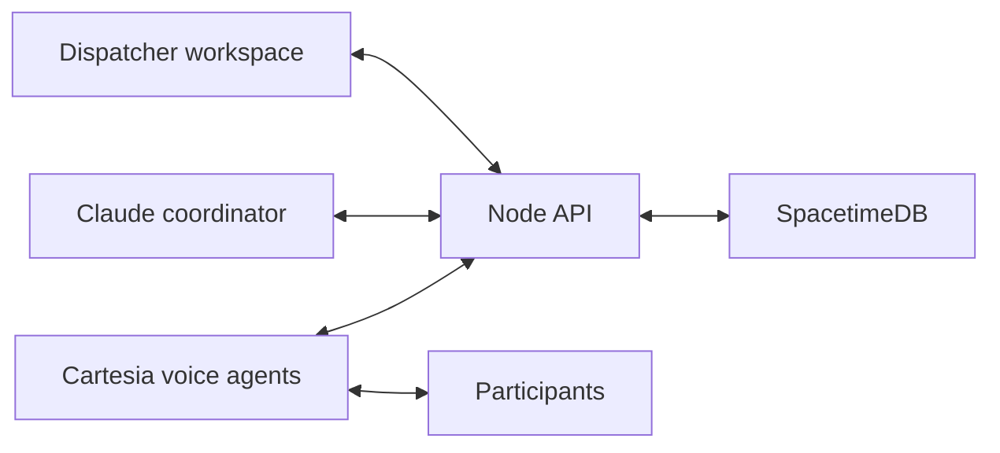

<div align="center">
  
  <h1>Sealert</h1>
  <p><em>A dispatcher's reliable sidekick</em></p>
</div>

An alert can tell someone to evacuate. It cannot tell you whether they have a car,
need an accessible ride, or could help a neighbor.

**Sealert helps dispatchers turn conversations into coordinated community assistance.**
A main coordinator works with a team of voice agents to contact people in parallel,
understand their needs, identify available help, and propose next steps. The dispatcher
can follow the conversations, give direction, and approve arrangements from one workspace.

## How it works

1. **Start with an incident.** Define the situation, objective, and people the team may contact.
2. **Reach people in parallel.** Voice agents introduce themselves, confirm who answered,
   and ask relevant questions. Findings reach the coordinator while calls continue.
3. **Adapt as information arrives.** The coordinator can revise an active agent's goal.
   Voice agents receive attributed context and choose how to clarify what is missing.
4. **Connect needs with available help.** Compare reported locations, willingness,
   passenger capacity, and accessibility requirements to propose suitable arrangements.
5. **Keep the dispatcher involved.** Surface unanswered calls, uncertainty, and requests
   for human help. The dispatcher reviews proposals and can authorize reassessment.
6. **Follow through.** Track approval, helper acceptance, recipient confirmation, pickup,
   and arrival as separate milestones. New information can change the plan.

The goal is to help a human coordinate many conversations and decisions at once,
while bringing people who need assistance together with people able to help.

## The dispatcher workspace

- **Parallel calls:** view call progress, inspect live transcripts, and play recordings
  when the provider makes them available after a call.
- **Coordinator conversation:** ask what is happening, provide context, and see updates
  from the team. Explicit controls authorize arrangements and further outreach.
- **Shared incident map:** compare reported locations and proposed assistance connections.
- **Evidence and history:** retain reports, corrections, and their sources across calls.
  A missing final summary does not erase findings already saved.
- **Human review:** keep unresolved needs visible and request a new assessment with a
  specific clarification goal.

The current demo exercises this flow through a fictional wildfire evacuation drill.
People's answers determine their roles and potential matches; names do not select fixed
pairings. Geographic comparisons use straight-line distance and supplied access constraints.
Live alert-feed monitoring and road navigation are future integrations.

## Architecture



The coordinator decides what information to pursue and proposes assistance. Voice agents
conduct the conversations and return findings. The backend enforces contact permissions,
evidence references, mission versions, and approval boundaries. SpacetimeDB preserves the
shared incident state for the dashboard and agents.

| Area | Technology / location |
| --- | --- |
| Dispatcher dashboard and maps | React, TypeScript, Vite — `src/` |
| API and agent coordination | Node.js, TypeScript — `server/src/` |
| Durable state and reducers | SpacetimeDB — `server/spacetimedb/` |
| Coordination model | Anthropic Claude |
| Voice calls and transcripts | Cartesia |

## Develop locally

Use Node.js 24, SpacetimeDB, and an HTTPS callback tunnel such as ngrok. Work from `main`
and install both sets of dependencies:

```bash
npm ci
npm --prefix server ci
```

Configure root `.env.local` using [`.env.sample`](.env.sample) as a starting point.
Supply the model and voice credentials, database connection, callback URL, and separate
operator/callback secrets. Keep credentials and participant phone numbers in private
configuration; frontend `VITE_*` variables are public.

Follow the [development and drill runbook](docs/assistance-demo.md) to publish the database
module, configure the hosted voice agent, and run the services. The local entry points are:

| Service | Address |
| --- | --- |
| Dispatcher dashboard | `http://127.0.0.1:5173` |
| API and voice callbacks | `http://127.0.0.1:8787` |
| Backend console | `http://127.0.0.1:8788` |
| SpacetimeDB | `http://127.0.0.1:3000` |

For an already configured environment, run the API and dashboard in separate terminals:

```bash
npm --prefix server run server
```

```bash
npm run dev
```

Publish database updates with `--delete-data=never`. When changing voice tools or
instructions, deploy the matching backend before running `npm --prefix server run setup-agent`.

## Team documentation

- [Development and drill runbook](docs/assistance-demo.md)
- [API contract](server/INFORMATION-API.md)
- [Access and authentication](server/ACCESS.md)
- [Domain glossary](GLOSSARY.md)
- [Architecture decisions](docs/adr/)
- [Issues and planned work](https://github.com/husseinhirani/Rideout/issues)

Build and type checks:

```bash
npm run build
npm --prefix server run check
```
